# Sylt – Rotes Kliff, das Projekt der Brandung

Der Weststrand von Sylt zwischen Wenningstedt und Kampen als 3D-Echtzeitszene in Java 21 und OpenGL 4.3: die Brandung über Riff und Rinnen, Auflauf und Rücklauf auf nassem Sand, Flugsand über Strand und Dünen, das Rote Kliff mit seinen Schichten, das Quermarkenfeuer und der Kampener Leuchtturm – vom stillen Sommerabend bis zur Sturmflut, in der das Kliff abbricht. Gelände, Kante und Häuser kommen aus den amtlichen Daten (DGM1, DOP20, LOD2), die Wellen, der Sand und der Bruch werden gerechnet. Fortsetzung von Brocken („Projekt der Luft“), mit den Packages aus `lib/Renderer.jar`; neu entstanden sind `surf` (die Brandung) und `dune` (Flugsand und Dünen), erweitert wurden `cliff`, `fracture`, `reed`, `flock` und `soundscape`, geholt wurde `beacon` aus Lighthouse.

**Stand: v1.0, Phase 19 von 19 abgeschlossen** (28.10.2026). Plan, Fortschritt und der Abschluss mit den offenen Punkten stehen im Artefakt „Sylt Werkbuch“.

[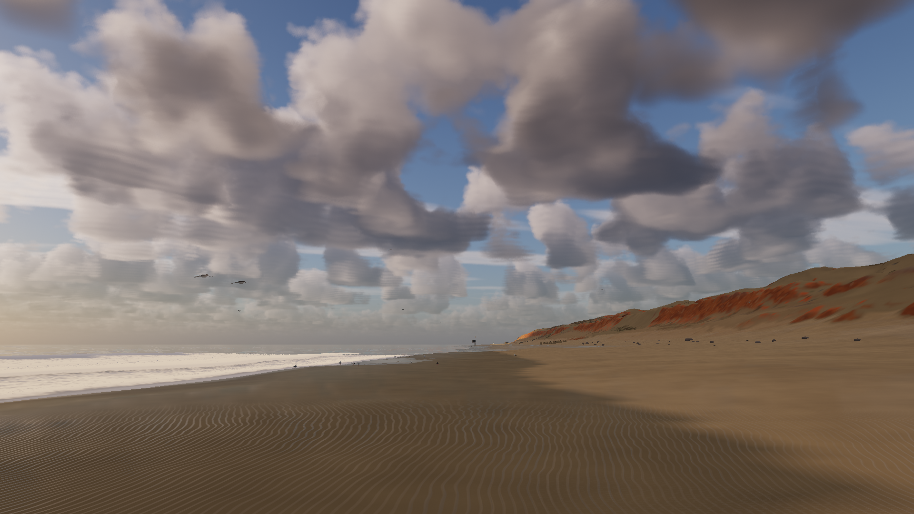](docs/video/Sylt_Vorschau.mp4)

*Vorschauvideo (30 s, Full HD, mit Ton): `docs/video/Sylt_Vorschau.mp4`*

| | |
|---|---|
| 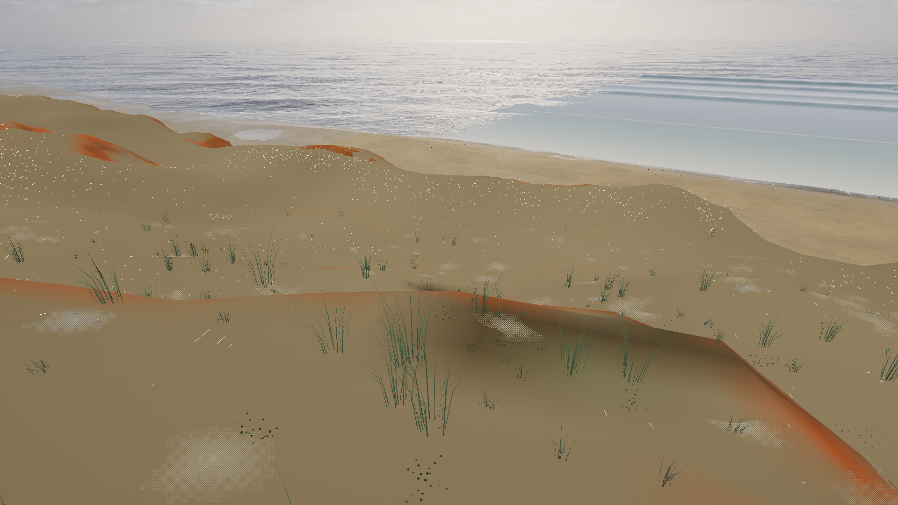 | 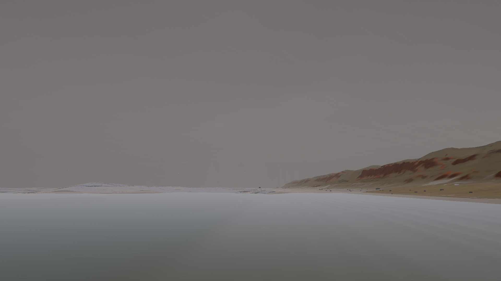 |
| **Kante und Brandung** – oben Strandhafer und Grasnarbe, unten läuft die Brandung phasenaufgelöst über Riff und Rinne und den Strand hinauf (`surf`, `dune`, `reed`). | **Sturmflut** – Orkan Xaver, 5. Dezember 2013: Windstau über 3 m, die Brandung schlägt eine Hohlkehle in den Fuß. |
| 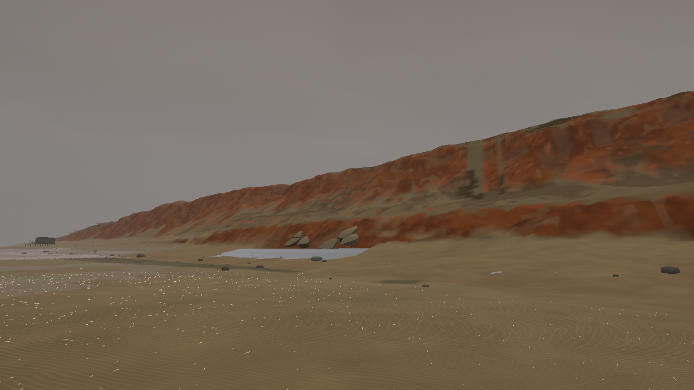 | 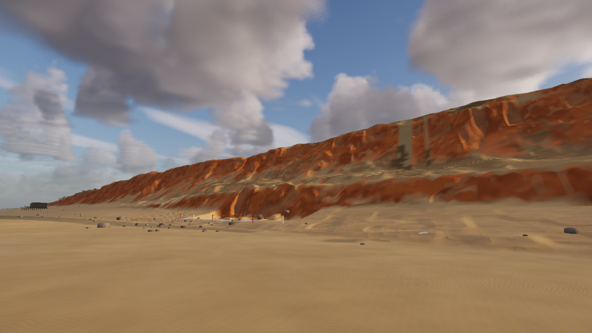 |
| **Abbruch** – wird die Kehle kritisch, rechnet `fracture` das Stück Kliff darüber: Geschiebelehm und Kaolinsand nach Mohr-Coulomb, nass schwächer. | **Einen Tag später** – Sturzkegel und Findlinge am Fuß, die nächste Flut trägt den Kegel ab; die Chronik schreibt die neue Kante. |
| 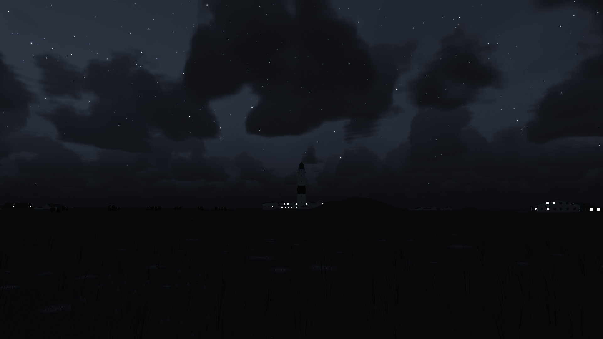 | 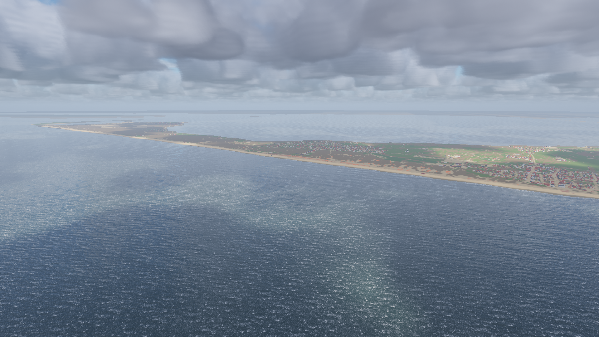 |
| **Leuchtfeuer** – Kampen Iso WR 7s mit Dämmerungsschalter und Strahl im Dunst (`beacon`), das Quermarkenfeuer heute dunkel. | **Vogelauge** – 2,3 × 3,6 km Kern zu 1 m, 15 160 Häuser aus LOD2, Fernfeld 16 km, Fernring bis zum Horizont. |
| 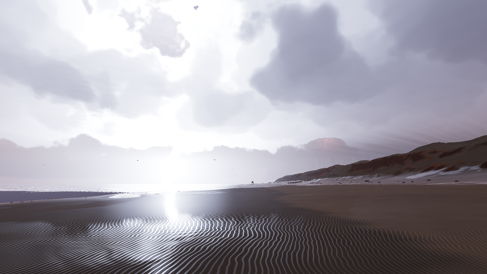 | 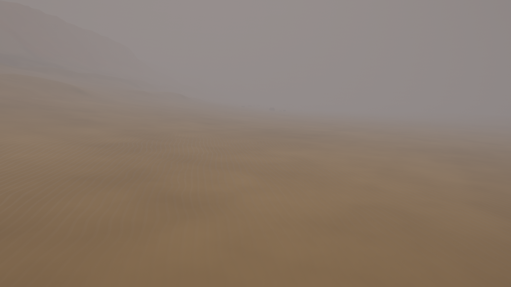 |
| **Wetter** – neun Lagen der Deutschen Bucht, Gewitter mit Fang an den Türmen, Regen in Vorhängen. | **Seenebel** – Nebel und Seerauch aus `fog`, die Leuchtfeuer streuen darin. |

Die Bilder rechnet `ant vorschaubilder` (Stufe Hoch, Full HD, ohne HUD), das Video `python3 tools/vorschau/vorschau.py` aus deren Bildfolgen und den Hörproben.

## Was die Szene kann

- **Brandung** (`surf`, Phasen 5–7a): Seegang über dem Grund mit Refraktion, Brechen nach Battjes und Janssen, Set-up, Längs- und Rippstrom; einzelne Wellen in Gruppen mit gezeichneten Brechern (Lippe, Hohlraum, Walze); der Schwall als Flachwassergleichung je Querprofil, nasser Sand, Spülsaum; der Pegel aus `Tide.westerland()` mit Windstau.
- **Sand** (`dune`, Phasen 8–9a): Flugsand nach Bagnold mit Feuchte, Bewuchs und Hang, Körner, Rippel, Dünenwanderung im Zeitraffer, Strandhafer, der Sand fängt.
- **Kliff** (`cliff`, `fracture`, Phasen 4–4a, 11–12): Schichten je Ort, Grasnarbe, Findlinge; Sturmflut nach Xaver, Hohlkehle, Abbruch mit Sandbilanz, Sturzkegel, Spur der Eiszeit, Vorspülung.
- **Türme und Bauten** (Phase 10): Häuser nach dem Ortsbild, Quermarkenfeuer und Kampener Leuchtturm, Treppe, Bohlenweg, Strandkörbe, eine Herde Galloways.
- **Wetter, Licht, Leben** (Phase 13): Wetterregie mit neun Lagen, Regen, Nebel, Gewitter, Meeresleuchten, grünes Leuchten, Möwen im Hangaufwind, Sanderlinge am Schwall, ein Seehund.
- **Klang** (Phase 14): ohne Audiodateien aus `soundscape` – die Brandungslinie, jede Welle einzeln, der Wind an der Kante, Vögel, Donner, der Abbruch.
- **Regie und Kino** (Phase 15): vier Regiebücher („Ein Abend am Kliff“, „Die Sturmflut“, „Ein Jahr am Kliff“, „Mit der Welle“), Fahrten (Treppe, Möwe, Drohne, Welle), Kinomodus mit Untertiteln.
- **Datenbank** (Phase 16): Schema SYLT mit 25 Tabellen und zwölf Sichten für QGIS, Chronik aller Abbrüche, Sturmfluten und Vorspülungen, „Weiter wie zuletzt“ mit dem Stand des Kliffs; ohne Datenbank dasselbe in Dateien.

## Qualitätsstufen

| Stufe | Auflösung | Ziel |
|---|---|---|
| Niedrig | 67 % | schwache Grafik |
| Mittel | 78 % (seit 19b) | 60 Bilder/s in Full HD auf der Radeon 680M, nie unter 30 |
| Hoch | 100 % | Standbilder, Kino |
| Ultra | 100 %, feinste See und Wolken | Standbilder |

Gemessen mit `ant stufen` (je Stufe Sommerabend und Sturmflut, ohne HUD nach 60 Bildern Vorlauf; die Zeiten schreibt das Ziel selbst nach `docs/status/Stufen_Phase19.txt`, die Konsole bitte nicht in dieselbe Datei umleiten). Im Dauerlauf auf der Radeon 680M in Full HD hielt „Mittel“ bei der Sturmflut 65–70 Bilder/s (Grafikkarte rund 13 ms), am Sommerabend 108–119; im Mittel über alle Stufen und Szenen 59 Bilder/s. Die Regelung der Auflösung hält das Ziel im Fenster.

## Klang

Hörproben ohne Grafikkarte (`ant hoerproben`), je ein WAV mit Spektrogramm in `docs/hoerproben/`:

| | |
|---|---|
| 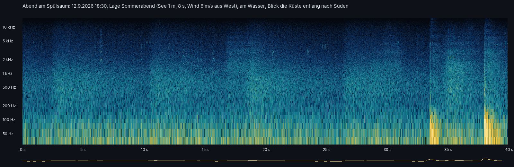 | 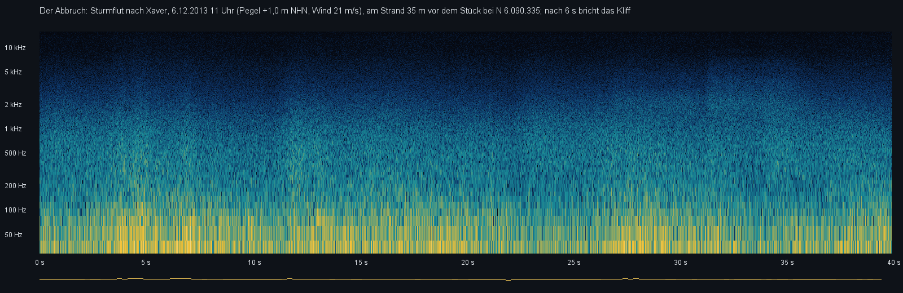 |

## Bauen und starten

- NetBeans-Projekt mit Ant, JDK 21. In `lib/`: `Renderer.jar`, JOGL mit Windows-Natives, `FStyle.jar`, `ojdbc11.jar`, `sdo*.jar`.
- **Clean and Build**, dann **Run** (Hauptklasse `com.dan.sylt.app.SyltApp`). Voraussetzung: OpenGL 4.3.
- Nach einer Änderung im Projekt Renderer: dort „Clean and Build“, dann hier `ant renderer` (kopiert `dist/Renderer.jar` nach `lib/` von Sylt, Lighthouse und Thunder); `check-packages` meldet, wenn etwas fehlt. `Renderer.jar` steht im Klassenpfad vor `FStyle.jar` (dieses bringt ältere Kopien von `com.dan.ground`, `forest`, `river`, `road` mit).
- **Prüfung:** `ant pruefung` endet mit „ERGEBNIS: alles in Ordnung“ (ohne Grafikkarte und Datenbank: Raum und Orte, die Bühne gegen die Profile der BAW, Gelände und Detailstufen, Ansichten, Uhr und Sonne, die Hüllen von `surf` und `dune` am Gelände, Renderer.jar, Shader, die aufbereiteten Daten mit Prüfsummen, Nähten, Kliff und Klassen, Regel „ohne C:\Daten“).
- **Aufbereitung (einmal):** `ant aufbereitung` (rund 3 Minuten; einzelne Schritte mit `-Dschritt=gelaende,kante,luftbild,bauten,inhalt`). Pfad der Rohdaten in `daten/rohdaten.properties` (legt der erste Lauf an, Vorgabe `C:\Daten\Sylt`); die BAW kommt beim ersten Lauf aus Rungholt nach `templates/rasters_BAW/`.
- **Statusbild:** `ant tempo` schreibt ein Statusbild (Grundansicht, Full HD, Stufe Mittel, volles HUD mit den Zeiten); `-Dansicht=Kliffkante` usw. wählt eine Ansicht, `-Dbild=…` den Dateinamen, `-Dwolken=aus`, `-Dboden=aus`, `-Dbedeckung=0..8` zum Vergleichen; seit Phase 7a `-Dsee=H_s,T_p,Richtung`, `-Dpegel=m` (von Hand statt Tide), `-Duhr=Stunde`, `-Ddatum=JJJJ-MM-TT`.
- **Schwall surf:** `java -cp "lib/Renderer.jar;lib/*" com.dan.surf.demo.SurfSwash` (Fenster) oder mit `--bild docs/status/Surf_Phase7.png [sekunden]`.
- **Testbecken surf:** `java -cp "lib/Renderer.jar;lib/*" com.dan.surf.demo.SurfBasin` (Fenster) oder mit `--bild docs/status/Surf_Phase5.png`.
- **Vorführung cliff (Lockergestein):** `java -cp "lib/Renderer.jar;lib/*" com.dan.cliff.demo.CliffDemo --kliff` (Fenster) oder mit `--bild docs/status/Cliff_Phase4.png 1800 --kliff` sechs Ansichten als Bild.
- **Datenbank:** Schema SYLT auf PDBORCL (`db/User.sql`). `db/db.properties` aus der Vorlage; ist das Passwort leer, fragt das Startbild danach und trägt es ein (oder Umgebungsvariable `Sylt_DB_PASSWORD`). „Einrichten“ im Startbild oder im Block DATEN führt `db/sql/01`–`04` aus und prüft alles (löscht nie etwas). `ant dbpruefung` prüft gegen die Datenbank (richtet ein, schreibt eine Chronik am 31.12.2099 und räumt sie weg). `ant startdaten` schreibt `04_startdaten.sql` neu. Ohne Startbild: `-Dsylt.splash=false` (mit `-Dsylt.weiter=true` gleich „Weiter wie zuletzt“), ohne Datenbank `-Dsylt.db=false`.
- **Regiebücher:** im Bedienfeld REGIEBÜCHER (im Kino oder im Fenster); ohne Fenster `ant regiebuecher` (`-Dbuch=Abend|Sturmflut|Jahr|Welle`), Blätter mit den Fotos nach `docs/status/Regiebuch_*.png`. Die Texte stehen in `src/com/dan/sylt/scene/regie/`.
- **Tasten:** F1 zeigt alle. Maus ziehen dreht und verschiebt, Rad zoomt, W A S D gleitet, F fliegt frei, R kreist, 1 bis 9 die Ansichten, V merkt die Ansicht (mit Vorschau), H das HUD, F11 nur die Szene, F12 ein Foto nach `docs/status/`, F5 lädt die Shader neu.

## Raum

UTM Zone 32 Nord (EPSG:25832), Ursprung am Quermarkenfeuer Rotes Kliff [G] bei E 457 600, N 6 091 170: x nach Osten, z nach Süden (Nord = −z), y über NHN. Kern 2,3 × 3,6 km (O 455 700–458 000, N 6 088 000–6 091 600), Fernfeld 16 × 16 km, Fernring rund 100 km. Raster (`scene.Terrain`): Kern 4 096² zu 1 m, Hauptraster 2 048² zu 10 m, Fernring 1 024² zu 100 m.

## Daten

Die Rohdaten (DGM1, bDOM, DOP20, LOD2 unter `C:\Daten\Sylt`, die BAW-Küstenhöhen) liest nur `ant aufbereitung` (`com.dan.sylt.tools`), einmal; die App liest nur `daten/` und startet auch, wenn `C:\Daten\Sylt` fehlt (Werkbuch 2.4). Fehlt `daten/`, zeigt sie die Bühne von Phase 1 und das Startbild sagt, was zu tun ist. Jede Rohdatei mit Stand und Lizenz: `docs/QUELLEN.md`. Quellenvermerke: Geobasisdaten © GeoBasis-DE/LVermGeo SH (Datenlizenz Deutschland); Küstenhöhen © BAW/EasyGSH-DB.

## Prüfen und Dauerlauf

- `ant pruefung` – die Prüfung ohne Grafikkarte und Datenbank, endet mit „ERGEBNIS: alles in Ordnung“ (`docs/status/pruefung_Phase19.txt`).
- `ant dbpruefung` – dasselbe gegen die Datenbank SYLT.
- `ant vorgaenger` – alle Prüfklassen in `lib/Renderer.jar` und die Vorgänger Brocken, Geiranger, Glacier, Lighthouse und Thunder mit diesem Jar übersetzt (`docs/status/Vorgaenger_Phase19.txt`).
- `ant dauerlauf` – 30 Minuten ohne Fenster: Lagen, Regiebücher und Kino, alle Ansichten und Fahrten, Blitze, Sturmflut mit Abbruch und Vorspulen, Vorspülung, Stufenwechsel, Klang offline, die Chronik schreibt in den Speicher der App; jede Minute der Zustand hin und zurück. Bestanden heißt: keine Ausnahme, kein Bild über 2 s, der Speicher wächst nach Minute 5 nicht mehr als 25 % (`docs/status/Dauerlauf_Phase19.txt`; `-Ddauerlauf.minuten=5` für kurz, `-Dbehalten=ja` lässt die Chronik stehen).
- `ant stufen`, `ant vorschaubilder` (`-Dohne.clips=ja` nur die Standbilder), `ant regiebuecher`, `ant abbruch`, `ant wetterbilder`, `ant vorlagen` – Bilder auf der Grafikkarte.

## Bekannte Grenzen (v1.0)

- Bei hoher Dünung (H_s 3,5 m) und flachem Blick vom Spülsaum wird die See vor dem Strand zu einer gleichmäßig weißen Fläche (Schaum ohne Struktur; `docs/bilder/Brecher.png`).
- Aus der Höhe (Drohne) sieht man den Rand des Netzes der Nahbrandung als helles Rechteck.
- Bei der Sturmflut wirkt die See grau und flach, Brecher sind aus der Ansicht am Kliff kaum zu sehen.
- Der Dauerlauf mit Datenbank meldete 15 Schreibfehler der Chronik (bei 50 Schreibvorgängen); seit v1.0 nennt das Protokoll die Fehlertexte. Ohne Datenbank (Dateien) schreibt die Chronik fehlerfrei.
- Die Kante von 1870 bis 2024 gibt es nicht als Bildfolge: Die Szene kennt die Kante 2024 und die Abbrüche der App.

## Entstehung

Die Phasen 1 bis 16 im Einzelnen

Phase 16, Oberfläche und Datenbank (F33–F45 alle A): Schema SYLT auf PDBORCL mit 25 Tabellen `SY_…` (Sequenz und Trigger, nie IDENTITY; `db/sql/01_tabellen.sql` bis `04_startdaten.sql`, `99_entfernen.sql` nur von Hand). Geometrien in UTM 32N (SRID 25832), die zwölf Sichten `SY_…_V` geben sie in WGS 84 (8307) für QGIS: `SY_KANTE_V` die Kante des Kliffs zu jedem Zeitpunkt (Stand 2024 in Stücken zu 25 m, jedes Stück nach einem Abbruch ersetzt die, deren Mitte es trifft; Filter auf `GUELTIG_AB_MS`/`GUELTIG_BIS_MS`), `SY_RUECKGANG_V` die abgebrochenen Flächen, `SY_ABBRUCH_V`, `SY_FINDLING_V`, `SY_VORSPUELUNG_V`, `SY_LEUCHTFEUER_V` (mit Sektoren), `SY_ANSICHT_V`, `SY_KUESTE_V` (alles als eine Ebene), dazu `SY_RUECKGANG_JAHR_V`, `SY_STURMFLUT_V`, `SY_BEFUND_V`, `SY_LETZTE_SITZUNG_V`. Szenenzeit als ms und `TIMESTAMP WITH TIME ZONE` in Europe/Berlin. Mitgeliefert (`ant startdaten` schreibt `04_startdaten.sql`): 28 Quellen, 28 Befunde, 20 belegte Sturmfluten an Sylt seit 1962 (Scheitel am Pegel List, Kliffschäden, wo belegt; recherchiert am 28.10.2026), 11 belegte Vorspülungen vor Wenningstedt und Kampen, das Gelände, die Kante 2024, zehn Lagen, beide Leuchtfeuer mit Sektoren, die vier Regiebücher mit Stichworten, 18 Ansichten, vier Fahrten, die Presets der Packages (dazu „Sommerabend“, „Westwind“, „Xaver“ für `surf` und `dune`). Die Chronik (`data.Chronik`) schreibt jeden Abbruch mit Bilanz, Kegel, Kehle, Pegel, Auflauf, neuer Kante, abgebrochener Fläche und Findling, jede Sturmflut der App (Scheitel, Windstau, Stunden am Fuß), jede Vorspülung, alle zehn Minuten die Serien und jeden Lauf eines Regiebuchs mit Blatt. „Weiter wie zuletzt“: Die Sitzung sichert alle zwei Minuten und beim Ende den ganzen Zustand mit dem Kliff (Änderung des Geländes, Kegel, Kehle, Kante, Spur, Vorspülung, gepackt) und ein Vorschaubild; nach dem Neustart steht das Kliff wie zuvor. Ohne Datenbank dasselbe in `daten/` (CSV mit WKT in EPSG:25832), „Übernehmen“ bringt es später in die Datenbank. Startbild: Neu, Weiter wie zuletzt (mit Datum und Bild), Im Kino, Einrichten, Ohne Datenbank, Beenden. Bedienfeld CHRONIK (Liste der Abbrüche, Sturmfluten und Vorspülungen, die Auswahl führt die Kamera hin; „Kliffkarte“ mit allen Kanten als PNG) und DATEN (Verbinden, Einrichten, Prüfen, Übernehmen, Weiter wie zuletzt, belegte Sturmfluten, Presets, gemerkte Ansichten mit Taste V, Protokoll). Prüfung mit der Datenbank: `ant dbpruefung` (oder `test/…/DbPruefung`, „Run File“). Phase 15, Regie und Kino: Vier Regiebücher als Text (`scene/regie/*.txt`, `scene.Regie`): „Ein Abend am Kliff“ (20.7.2026: die Treppe hinunter, Strandkörbe, Sanderlinge aus dem Auge eines Strandläufers, mit einer Möwe im Aufwind, Sonnenuntergang über der See, das Kliff glüht, Kampen geht an), „Die Sturmflut“ (Xaver 5. bis 7.12.2013: Sturm, Windstau, Brecher am Fuß, die Hohlkehle, der Abbruch, der Morgen danach mit Sturzkegel und Findlingen), „Ein Jahr am Kliff“ (Juni 2026 bis Juni 2027: Sommer, Gewitter, Sanderlinge, Herbststurm, die Wintersturmflut mit Abbruch, die Vorspülung im März, der Sommer danach) und als Kür „Mit der Welle“ (auf dem Kamm einer Welle vom Riff bis an den Strand, durch den Hohlraum unter der Lippe, kurz unter Wasser, mit der Walze und dem Schwall hinauf). Befehle: zeit, raffer, lage, regie, sturmflut, abbruch, vorspuelung, ansicht, fahrt, warte (uhr, abbruch, ruhe, serie, welle, vorspuelung), foto, blatt, sage. Fahrten: Treppe, Möwe, Drohne, Welle (`scene.Wellenritt`). Im Kino (`com.dan.kino`): Vollbild ohne Bedienfeld, Balken 2,39 : 1, Vor- und Abspann, Untertitel aus den Stichworten, Überblendung bei jedem Schnitt, der Ton blendet mit; Esc heraus, Leertaste hält an. Aus dem Ideenspeicher: die Vorspülung (`scene.Vorspuelung`, ein Sandkörper vor dem Kliff, den die Brandung abträgt), die Spur der Eiszeit (nach jedem Abbruch Findlinge am Fuß und Pflöcke an der Linie, wo die Wand stand), die Welle von unten (unter Wasser in der Fahrt mit der Welle), die Serie (`scene.Serie`, große Wellen in Gruppen, im HUD). Im Gewitter, Regen und Sturm schweigen die Vögel (Befund aus Phase 14). Bedienfeld REGIEBÜCHER: Buch, „Von vorn“, „Anhalten“, „Im Kino zeigen“, „Mit der Welle“, „Vorspülung“. Ohne Fenster: `ant regiebuecher` (alle vier, je ein Blatt `docs/status/Regiebuch_*.png`; eines: `-Dbuch=Welle`). Phase 14, Klang: Die Szene klingt, erzeugt mit `com.dan.soundscape`, ohne Audiodateien (F27 A, `gl.Klang`). Das Ohr ist die Kamera. Die ferne Brandung ist eine Linie aus dem Wellenfeld von `surf`: je 25 m auf ±2,4 km die Leistung, die in der Brandung vergeht, und die Art der Brecher (neu in `soundscape`: `surfLine`, Schallleistung 3·10⁻⁷ der vergehenden Leistung [G], drei Bänder, die Luft nimmt die Höhen, fern bleibt das Rollen). Im Stück der Nahbrandung klingt jede Welle einzeln: der Schwallbrecher zischt, die Lippe des Sturzbrechers schlägt, der Schwall läuft hinauf und zischt über den Sand zurück (neu: `SCHWALLBRECHER`, `STURZBRECHER`, `SCHWALL`). Oben hinter der Kliffkante dämpft die Kante (Beugung nach Maekawa). Wind aus dem Windfeld (über der Kante schneller), die Kante heult im Sturm, Strandhafer raschelt, Flugsand prasselt (neu: `sandFlux`, `marramNear`). Möwen, Sanderlinge (neu: `SANDERLING`), Austernfischer, der Seehund, selten eine Kuh; Regen und Donner mit Laufzeit; der Abbruch des Kliffs mit Reißen der Grasnarbe, Grollen, Aufschlag und Rieseln (neu: `ABBRUCH`, `ERDBROCKEN`, `RIESELN`; `Kliffabbruch.onKlang`). Bedienfeld KLANG: Ton an (gemerkt), Lautstärke, Anpassung des Ohrs, Teile an und aus. Hörproben ohne Grafikkarte: `ant hoerproben` (`docs/hoerproben/*.wav` mit Spektrogramm und `hoerproben.txt`; eine: `-Dnur=abbruch`). Phase 13, Wetter, Licht, Leben: Eine Wetterregie aus `com.dan.weather` führt die Szene (`wiring.Wetterregie`): neun Lagen nach dem Werkbuch (Sommerabend als Vorgabe wie bis Phase 12, Westwind, Ablandig, Schauer über See, Landregen, Sturm, Seenebel, Seerauch, Gewitter über der See), freie Regie mit der Markow-Kette der Deutschen Bucht oder das Regiebuch „Ein Sturmtag“; „von Hand“ wie bisher, während der Sturmflut führt ihr Fahrplan. `gl.Unwetter` zeichnet Regen in Vorhängen unter den Wolken (`rain`), Seenebel und Seerauch (`fog`) und Gewitter über der See mit Fang an den Türmen (`lightning`); der Blitz erhellt Himmel, Wolken, Gelände und See. Regen macht Sand und Kliff nass (der Flugsand liegt dann), Nebel streut die Leuchtfeuer, das Quermarkenfeuer kann nachts angestrahlt werden. Licht: Meeresleuchten im Sommer in Brechern und Schwall (`surf.Bioluminescence`, Noctiluca, Blüte nach Monat und Wassertemperatur), das grüne Leuchten am Sonnenrand (`sky.GreenFlash`, an manchen klaren Sommerabenden mit Spiegelung). Leben (`scene.Strandleben`, `gl.LebenGl`): Möwen aus `flock` segeln im Hangaufwind vor der Kante und sitzen auf Kante und Buhnen; am Spülsaum laufen Sanderlinge (neu in `flock`), Austernfischer und Silbermöwen dem Schwall nach (`flock.Shorebirds`) und hinterlassen Spuren im nassen Sand, die der nächste Schwall löscht (`mudflat.TrackMap`); selten (etwa eine Stunde von sechs) schwimmt ein Seehund vor dem Strand (`seal`). Bedienfeld WETTER (Regie, Regen, Nebel, Gewitter, Blitz, Licht), BRANDUNG „Leben am Strand“, TÜRME „Dazu nachts angestrahlt“. Bilder auf der Radeon: `ant wetterbilder` (`docs/status/Wetter_*.png`), `ant tempo -Dlage=Gewitter -Dblitz=see`. Frei stehend liegt das Ziel der Kamera jetzt 40 m voraus (das Netz der Nahbrandung folgt dem Blick). Die Bildfolge `ant abbruch` beginnt seit Phase 13 am hellen Vormittag. Phase 12, Sturmflut und Abbruch des Kliffs: Die Sturmflut kommt in die Szene. Ein Szenario nach Orkan Xaver (5. bis 7. Dezember 2013, `scene.Sturmflut`, F16 A) führt Wind, Richtung, Seegang und Bedeckung; den Pegel macht `Tide.westerland()` mit dem Windstau aus diesem Wind, bis +3,2 m NHN in der Nacht zum 6. Reichen Pegel und Auflauf (Stockdon R2 %) an den Fuß, schlägt die Brandung je Meter Kante eine Hohlkehle (`scene.Kliffabbruch`, im Bild über die Schichtkarte von `cliff`). Wird sie irgendwo kritisch (0,6 · L_c), rechnet `fracture` das Stück Kliff darüber (30 m längs, 1 200 Zellen): Der Bestand steht, wie er ist (`Solid.stabilize`, neu), die Kehle spült aus, die Wand ist bis über den Auflauf durchnässt, und die Spannung entscheidet, was bricht (F17 A). Die Brocken fallen, liegen als Sturzkegel im Gelände und die nächste Flut trägt ihn ab; Staub steigt beim Aufschlag als Dünenkörner auf (`Grains.burst`, F15 A). Das Gelände ändert sich über eine Korrektur zu 1 m (`scene.Aenderung`, R32F-Textur `uKorr`), Wandkarte und Grasnarbe folgen der neuen Wand. Die Sandbilanz rechnet mit: gerechnet = steht + Blöcke + zerfallen + ausgespült, Kegel = (Blöcke + zerfallen) · 1,3, dazu Abtrag. `wave` wird nicht genutzt: Die Flut über den Strand ist die See auf dem Pegel der Sturmflut mit Brandung und Auflauf aus `surf`. Bedienfeld KLIFF: „Sturmflut (Xaver 2013)“ (Zeitraffer 12 min/s), „Abbruch hier“ (am Ziel der Kamera), Brocken an/aus. Bildfolge auf der Radeon: `ant abbruch` (`docs/status/Abbruch_1..6.png`, Stelle `-Dnord=`, Stunde `-Dstunde=`); Querschnitt ohne Grafikkarte mit Sandbilanz: `ant abbruchbild` (`docs/status/Abbruch_Schnitt.png`). Phase 11, fracture für Lockergestein: Im Projekt Renderer kann `com.dan.fracture` jetzt Lockergestein. Mohr-Coulomb mit Kohäsion (`Material.mohrCoulomb`), Presets `geschiebelehm()` (c 120 kPa, φ 32°) und `kaolinsand()` (c 6 kPa, φ 35°), dazu `flugsand()`. Feuchte macht schwächer (`Solid.soak`): Der Lehm verliert nass ein Drittel, der Sand hält nur erdfeucht (Menisken), trocken und nass rieselt er. Unterspülung als Hohlkehle (`Solid.undercut`, `Solid.erode`): Das Ausgespülte wird als Sediment gemeldet, der Überhang reißt hinter der Kante ab (geprüft gegen L_c = √(f_t·h/3ρg)). Ein Stück, das hart aufschlägt, zerfällt zu Sand (`onDisintegrate` mit Volumen, Ort und Halbmesser für den Sturzkegel). Eis, Fels, Beton und Klei rechnen unverändert; die Gletscherfront der Vorführung bricht wie vor Phase 11. Vorführung: `java -cp "lib/Renderer.jar;lib/*" com.dan.fracture.demo.FractureDemo`, neuer Fall „Kliff bricht ab“, Bild `docs/status/Fracture_Phase11.png`. `FractureCheck` läuft in `ant pruefung` mit. In der Szene kommt das mit Phase 12 (Sturmflut). Phase 10, Türme und Bauten: Die Häuser aus LOD2 stehen in der Szene (`scene.Bauten`, 15 160 Häuser) mit Baustoffen nach dem Ortsbild: Reet über rotem Backstein (in Kampen am häufigsten), Putz, gelber Klinker, rote und graue Dächer, nachts zum Teil erleuchtete Fenster; die Wärterhäuser am Kampener Leuchtturm weiß mit grauem Dach. Das Quermarkenfeuer (Achteck aus Backstein auf Granitsockel, schwarze Galerie, weiße Laterne, Kupferdach, 12 m) und der Kampener Leuchtturm (weiß, sich verjüngend, schwarzes Band, zwei Galerien, schwarze Laterne, 40 m) sind genauer gebaut; dazu die Treppe am Kliff bei N 6 089 900, der Bohlenweg und der Kiesweg zum Quermarkenfeuer mit Bank und Pfählen, ein Strandlokal und Rettungstürme (`scene.Bauwerke`, `scene.Netz`, `gl.BautenGl`, `bauten.vert/frag`). Strandkörbe von Mai bis September, mit dem Rücken zum Wind, bei Sturmwarnung (ab Bft 8) weggeräumt (`scene.Strandkoerbe`, F20 A); eine Herde Belted Galloways grast westlich des Kampener Leuchtturms (`scene.Herde`, F24 A). Leuchtfeuer aus `com.dan.beacon` (`scene.Leuchtfeuer`, `gl.FeuerGl`, F18 A): Kampen Iso WR 7s, Feuerhöhe 62 m, mit Dämmerungsschalter, Strahl im Dunst, Lichtpunkt und leuchtender Laterne; das Quermarkenfeuer heute dunkel, „wie früher“ F WRG (F19 A). Die Kamera hat jetzt eine Öffnung je Ansicht; die acht Vorlagen Leuchturm1–4 und Kampen1–4 stellen Ansicht (Kampen1–3 mit Fernrohr), Tag und Stunde: Block TÜRME, `ant vorlagen` (Bilder `docs/status/Vorlage_*.png` auf der Radeon), `ant tempo -Dvorlage=Kampen1`, Vorschau ohne Grafikkarte `ant bautenbild` (`docs/status/Vorschau_*.png`, neben der Vorlage). Nachgebessert: die Walzen in `ocean` flacher, weicher und an der Front weiß (Tafeln im Statusbild 9a); „Sandsturm am Strand“ sucht bei Hochwasser trockenen Sand. Phase 9a, Dünen in der Szene: Flugsand aus `com.dan.dune` in der Szene (`scene.Sand`, `gl.SandGl`) mit dem Wind aus `com.dan.wind` (F21 A: massenkonsistentes Feld über dem Kern, im eigenen Faden, Rauigkeit nach der Art des Grunds). Der Sand nimmt die Nässe aus Pegel, Auflauf und Schwall (der nasse Strand fliegt nicht, ab 6 % Wasser ist er gebunden), den Bewuchs aus der Karte (Heide, Gebüsch, Kliffwand ohne losen Sand). Ein Feld um das Auge (240 × 160 m zu 0,5 m) rechnet im Hintergrund neu, wenn das Auge wandert; die Körner springen um das Auge. Block SAND: Flugsand und Körner an/aus, Regen, Knopf „Sandsturm am Strand“ (Bft 9 aus West, Blick vom Strand). Prüfbild ohne Grafikkarte: `java -cp "build/classes;lib/Renderer.jar;lib/*" com.dan.sylt.tools.SandBild docs/status/Sand_Phase9a.png`; Statusbild: `ant tempo -Dsandsturm=an`. Dazu stetiges Relief der Walzen in `ocean` (die schrägen Tafeln im Statusbild 9 sind weg). Phase 9, dune II und Strandhafer: Im Projekt Renderer hat `com.dan.dune` jetzt ein Höhenfeld des losen Sands (`SandBed`, Platten zu 5 cm) und die Dünenwanderung im Zeitraffer nach dem Plattenmodell von Werner (`Werner`, F12 A) im eigenen Faden (`TimeLapse`): Windschatten, Lawinen bis zum Schüttwinkel, Sand erhalten (Zu- und Abfluss gezählt, die Tide hält den Strand). Strandhafer fängt und hält Sand, wächst bis 1 m im Jahr durch die Übersandung, stirbt unter zu viel Sand; Sandfangzäune aus Busch sanden ein. In `com.dan.reed` neu die Art `STRANDHAFER` und die Übersandung (`Reed.Burial`). Vorführung: `java -cp "lib/Renderer.jar;lib/*" com.dan.dune.demo.DuneDemo` (Taste Z Zeitraffer, F Zäune, R neu), `--zeitraffer docs/status/Dune_Phase9.png` ohne Grafikkarte (eine Wanderdüne im Windriss, die Vordüne mit Strandhafer, zehn Jahre), Mesa-Vorschau `docs/status/Dune_Phase9_Mesa.png`; `DuneCheck` 56 Prüfungen, `ReedCheck` grün. In der Szene kommt das mit Phase 9a. Phase 8, dune I – Flugsand: Im Projekt Renderer rechnet `com.dan.dune` den Flugsand (F11 A): Schwelle nach Bagnold mit Feuchte (Belly), Bewuchs (Raupach) und Hang (Dyer), Fluss nach Bagnold; ein Feld in Windrichtung (`FluxField`) mit Beschleunigung über dem Kamm (Kroy u. a.), Windschatten hinter dem Kamm, Sättigungslänge und Ablagerung bei erhaltenem Sand; Saltation als Körner (`Grains`) mit Sandfahnen in Böen und Kammfahnen ins Lee; Windrippel (`Ripples`), die mit dem Fluss wachsen und wandern; `gl/DuneGl` zeichnet Boden mit Rippeln und die Körner. Vorführung: `java -cp "lib/Renderer.jar;lib/*" com.dan.dune.demo.DuneDemo` (Tasten 1 Strand, 2 Kamm, 3 Übersicht; `--bild datei.png` auf der Radeon, `--profil datei.png` ohne Grafikkarte, Bild `docs/status/Dune_Phase8.png`), Mesa-Vorschau `docs/status/Dune_Phase8_Mesa.png`, `DuneCheck` 42 Prüfungen. In der Szene kommt das mit Phase 9a. Neu in der Szene: drei Buhnen bei Wenningstedt mit geschätzter Lage [G] (im Luftbild 2024 nicht zu sehen); die Brandungsringe legt `ocean` nur um die Buhnen nahe am Auge. Phase 7a, die Brandung in der Szene: Der Pegel kommt aus `Tide.westerland()` (F25 A, zehn Partialtiden, Hub 1,76 m) mit Windstau. Vor dem ganzen Kern rechnet `scene.Brandung` das Wellenfeld aus `com.dan.surf` (Grund aus dem Gelände mit Riffen und Rinnen, im eigenen Faden, wenn sich See, Pegel oder Grund ändern) und backt daraus eine Textur, die `com.dan.ocean` als „Brandung von außen“ zeichnet: Walzen, die mit der Phase der Wellen zur Küste laufen, Weißwasser, Schaumteppich, Set-up und Rippströme. Nahe am Auge liegt das Netz der Brecher mit Auflauf (`scene.Nahbrandung`, Phase 6 und 7, die See lässt dort ein Loch), der Sand nimmt die Nässe aus dem Schwall. Die Pfähle der Buhnen stehen, wo das Luftbild sie zeigt (Kliffende, Kampen). Im Bedienfeld schaltet SEE die Tide, BRANDUNG das Netz, die Buhnen, die Strömung und den DLRG-Blick. Prüfbild ohne Grafikkarte: `java -cp "build/classes;lib/Renderer.jar;lib/*" com.dan.sylt.tools.BrandungBild docs/status/Brandung_Phase7a.png 2.5 9 290` (H_s, T_p, Richtung); Statusbild auf der Radeon: `ant tempo -Dansicht=Kliffkante -Dsee=2.5,9,290`. Phase 7: im Projekt Renderer laufen die Walzen in `com.dan.surf` als Schwall den Strand hinauf und zurück (`Swash`: Flachwassergleichungen je Querprofil, 0,5-m-Zellen, nass und trocken, Reibung, Versickern), mit Auflaufspitzen und Stößen als Ereignissen, nassem Sand, der nach dem Wetter trocknet (Film, Nässe, Grundwasser), Blasen und Spülsaum mit Tang und Schill; die Auflaufhöhe liegt bei 76–109 % von Stockdon (2006). Vorführungen: `java -cp "lib/Renderer.jar;lib/*" com.dan.surf.demo.SurfSwash` (ohne Grafikkarte, Bild `docs/status/Surf_Phase7.png`) und `… SurfBreakers` (Taste S: Blick auf den Strand), Mesa-Vorschau `docs/status/Surf_Phase7_Mesa.png`, `SurfCheck` 72 Prüfungen. In der Szene kommt das mit Phase 7a. Phase 6: im Projekt Renderer laufen in `com.dan.surf` einzelne Wellen phasenaufgelöst über den Grund (`WaveTrain`: Rayleigh in Gruppen, Brechen bei γ·h, Typ nach Battjes), mit gezeichneten Formen (`BreakerShape`: Schwallbrecher, Sturzbrecher mit Lippe und Hohlraum, Reflexionsbrecher, Walze), Schaumteppich mit Nachleuchten (`FoamField`), Brandungsschwebung und Gischt über `spray` beim Aufschlag der Lippe; `BreakerMesh` und `gl/BreakerGl` bauen und zeichnen das Netz. Vorführung: `java -cp "lib/Renderer.jar;lib/*" com.dan.surf.demo.SurfBreakers` (drei Becken nebeneinander), Mesa-Vorschau `docs/status/Surf_Phase6_Mesa.png`, `SurfCheck` 53 Prüfungen. Phase 5: im Projekt Renderer rechnet `com.dan.surf` den Seegang über dem Grund auf einem Gitter (`WaveField`: Refraktion, Shoaling, Brechen nach Battjes und Janssen, Set-up, Längsstrom, Unterstrom und Rippströmung, im eigenen Faden) und legt Riffe und Rinnen auf den Grund (`Bars`, nach Stürmen verlagert); `SurfCheck` 34 grün; Testbecken `SurfBasin` (`docs/status/Surf_Phase5.png`). In der Szene kommt das mit Phase 7a. Phase 4a: das Rote Kliff in der Szene aus `cliff` (Schichten je Ort, Grasnarbe, Findlinge, Strandhafer am Fuß). Phase 4: `cliff` kann Lockergestein (`Cliff.rotesKliff()`, `StrataMap`, `Sod`; `CliffDemo --kliff`). Phase 3: das Grundbild (Himmel und Wolken aus `sky` und `cloud`, offene See aus `ocean`, Strand aus `mudflat.beach`, Biom „Sylt“ in `ground`, Bedienfeld WETTER). Phase 2: die Datenaufbereitung (`ant aufbereitung` schreibt `daten/`, rund 207 MB, mit `daten/INHALT.txt`; LOD2 vollständig: 15 162 Gebäude). Phase 1: das Gerüst (Engine aus Brocken entschlackt, Bedienfeld, HUD, Ansichten, Marken; im Projekt Renderer `surf`, `dune`, `beacon`). Plan und Fortschritt stehen im Artefakt „Sylt Werkbuch“.

Phase 17 und 18: Thunder in 3D (eigenes Projekt). Phase 19, Schliff: Stufen gemessen, Symbol und Startdateien (`Sylt.bat`, `Sylt_Konsole.bat`, `Sylt_Verknuepfung.bat`), `docs/QUELLEN.md` aus den Tabellen (`ant quellen`), die Vorgänger geprüft (`ant vorgaenger`); 19b: „Mittel“ auf 78 %, Vorschaubilder, Video, Dauerlauf.

